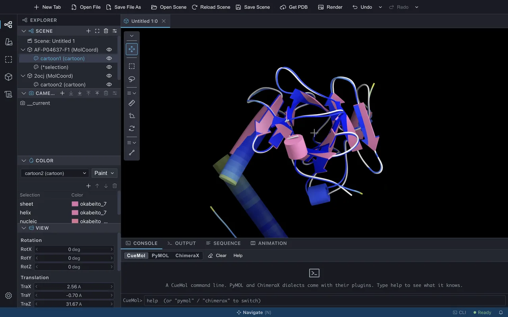
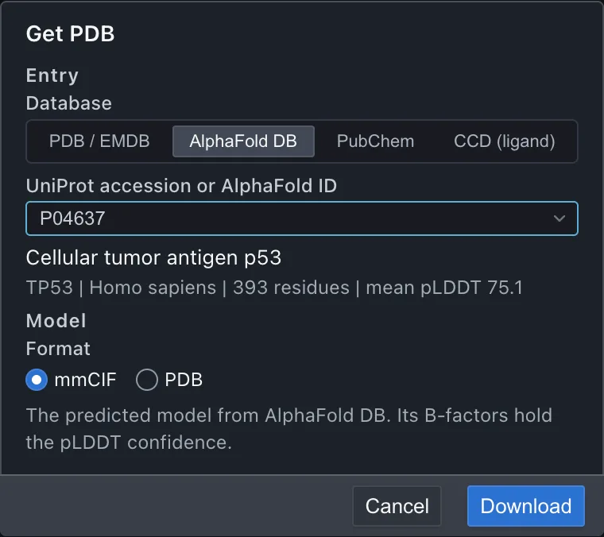
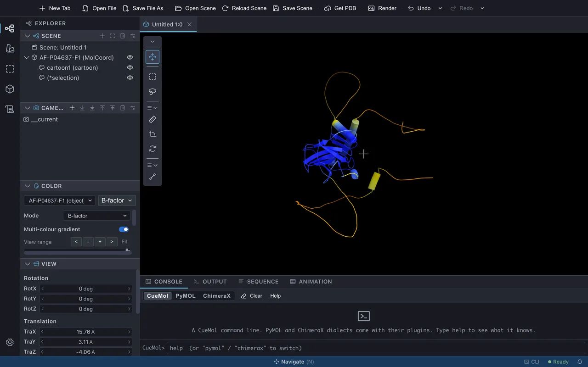
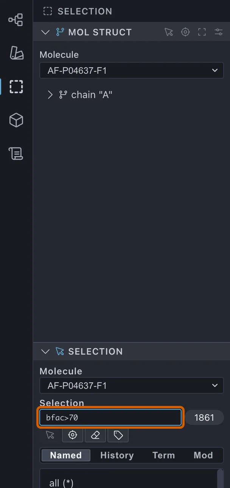
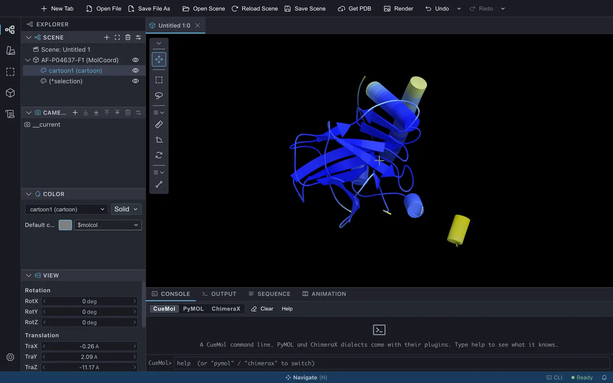
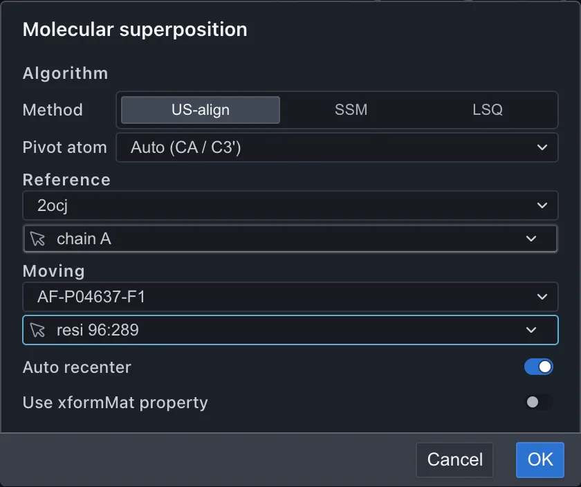

# AlphaFold の予測構造の評価

AlphaFold DB から予測構造を取得し、予測の信頼度 (pLDDT) の値を色で可視化したうえで、
信頼度の高い部分を実験構造と比べる手順を追います。
題材にはヒトのがん抑制タンパク質 p53 (UniProt accession: **P04637**) を使います。
全長 393 残基のうち、構造をとるドメインと、決まった構造をとらない領域がはっきり分かれています。
比べる実験構造は、p53 の DNA 結合ドメインの結晶構造 (PDB ID: **2OCJ**) です。

!!! abstract "このチュートリアルについて"
    - **題材**: ヒト p53 の AlphaFold 予測構造 (UniProt: P04637) と、DNA 結合ドメインの結晶構造 (PDB ID: 2OCJ)
    - **学ぶこと**: Get PDB での AlphaFold DB からの取得、pLDDT 値の可視化、温度因子による選択、US-align による重ね合わせ
    - **前提**: 基本操作コースの [Renderer の着色](../basic/coloring.md) まで

{ .on-glb }

## 1. AlphaFold DB から取得する

1. **File &gt; Get PDB...** で **Get PDB** ダイアログを開きます。
2. **Database** で **AlphaFold DB** を選びます。
3. **UniProt accession or AlphaFold ID** に `P04637` を入力します。
   入力欄の下に、タンパク質の名前と、遺伝子・生物種・残基数 (393)・mean pLDDT が表示されます。

    { width="380" .on-glb }

4. **Format** は既定の **mmCIF** のままで **Download** を押します。
5. Renderer は **cartoon** を選びます。

Object 名は `AF-P04637-F1` になります。読み込んだ構造は、予測の信頼度 (pLDDT) に応じた色で
表示されます (→ [PDB からの取得 (Get PDB)](../../reference/get-pdb.md#alphafold-db))。

!!! note "入力できる ID の形"
    UniProt accession (`P04637`) のほかに、AlphaFold ID の完全な形 (`AF-P04637-F1-v6` など) も入力できます。
    `AF-P04637` のような途中までの形は受け付けられません。

## 2. pLDDT 値を可視化する

pLDDT は、AlphaFold が残基ごとに出す予測の信頼度 (0〜100) です。AlphaFold のモデルは
pLDDT を B-factor の欄に持っており、CueMol3 はその値で次のように塗ります
(→ [Coloring](../../reference/coloring.md#bfacocc))。

| pLDDT | 色 |
|---|---|
| 100 | 青 |
| 90 | 水色がかった青 |
| 70 | 黄 |
| 50 | 橙 |
| 0 | 赤 |

色は、表の値の間で連続的に変わります。青に近いほど信頼度が高く、橙や赤に近いほど低い予測です。原子をクリックすると、ステータスバーの **B** に
その残基の pLDDT が表示されます。

P04637 のモデルを回して見ると、色は領域ごとに次のように分かれています。

| 残基 | 主な色 | 領域 |
|---|---|---|
| 1〜95 | 橙・黄 (一部に黄緑) | 転写活性化ドメインとプロリンに富む領域 |
| 96〜290 付近 | 青 | DNA 結合ドメイン |
| 291〜325 付近 | 橙・黄 | DNA 結合ドメインと四量体化ドメインをつなぐ部分 |
| 326〜356 付近 | 青 | 四量体化ドメイン (1 本のヘリックスとストランド) |
| 357〜393 | 橙 | C 末端の領域 |

{ .on-glb }

DNA 結合ドメインはまとまった立体構造として予測されています。
一方、橙や黄の部分は、分子の周りを大きく回り込む紐のような形になっています。

!!! warning "pLDDT の読み方の注意"
    - pLDDT が低いことは、その領域の形を AlphaFold が確信をもって予測できなかったことを
      示します。p53 の N 末端・C 末端は決まった構造をとらないことが実験で知られていますが、
      pLDDT が低いだけで「構造をとらない領域」と決めることはできません。
      ほかの分子と結合したときにだけ構造をとる領域なども、低い値になることがあります。
    - pLDDT は残基ごとの局所的な信頼度です。ドメインどうしの相対的な位置
      (たとえば DNA 結合ドメインと四量体化ドメインの位置関係) が正しいかどうかは示しません。
    - 紐のような部分の形そのものには、意味がありません。

## 3. 信頼度の高い部分だけを表示する

pLDDT が 70 を超える部分だけを cartoon で表示します。

1. 左サイドパネルの **Selection &gt; Selection** パネルを開き、**Molecule** で `AF-P04637-F1` を選びます。
2. **Selection** 欄に `bfac>70` を入力し、++enter++ を押します (欄の下の適用ボタンを押しても同じです)。
   B-factor (ここでは pLDDT) が 70 より大きい原子が選択されます
   (→ [選択式の文法](../../reference/selection.md#温度因子による選択))。

    { width="304" .on-glb }

3. シーンツリーで `cartoon1` を右クリックし、**Change sel &gt; Current** を選びます。

cartoon の表示範囲が、選択した部分に置き換わります。DNA 結合ドメインと四量体化ドメインの
ほかに、短い断片がいくつか残ります。

{ .on-glb }

!!! note "比較の演算子"
    温度因子による選択で使える比較は `<` / `>` / `=` の 3 つです。`>=` は使えません。

## 4. 実験構造を読み込む

1. **File &gt; Get PDB...** で `2OCJ` を取得します (**Database** は、ダイアログを開くたびに **PDB / EMDB** に戻ります)。
2. Renderer は **cartoon** を選び、**Selection** にチェックを入れて **Atoms** に `chain A` を入力します。

2OCJ の非対称単位には DNA 結合ドメインが 4 本 (chain A〜D) 含まれています。
ここでは chain A (残基 96〜289) だけを表示します。

読み込んだ直後の 2OCJ は分子ごとの既定の色 (水色) で、pLDDT の青と見分けにくいので、色を変えます。

1. 左サイドパネルの **Explorer &gt; Color** パネルを開き、上部で `2ocj` の `cartoon2` を選びます。
   GUI で作る Renderer の名前はシーン全体で重ならないように付くので、2 つ目の cartoon は `cartoon2` になります。
2. Coloring の種類から **Paint coloring** &gt; **Okabe-Ito** &gt; **Reddish purple** を選びます。

2OCJ が赤紫に変わります (→ [Renderer の着色](../basic/coloring.md))。

## 5. 予測構造を実験構造に重ね合わせる

**Tools &gt; Molecular superposition...** で **Molecular superposition** ダイアログを開きます
(→ [分子の重ね合わせ (Molecular superposition)](../../reference/tools/superpose.md))。

1. **Method** は既定の **US-align** のままにします。
2. **Reference** の Molecule で `2ocj` を選び、Selection に `chain A` を指定します。
3. **Moving** の Molecule で `AF-P04637-F1` を選び、Selection に `resi 96:289` を指定します。
   2OCJ の chain A にある範囲と同じ残基だけを重ね合わせに使います。
4. **OK** を押すと、予測構造が 2OCJ の位置に移動します。

    { width="420" .on-glb }


結果は下部パネルの **Output** に表示されます。**RMSD** (対応づけた Cα 原子の RMSD) は約 0.51 Å、
**TM-score** は約 0.99 で、1 に近い値になります。青の DNA 結合ドメインが、赤紫の 2OCJ とほぼ重なって
見えるはずです。

{ .on-glb }

分子を回して、ストランドやループが重なっているか、ずれている部分があるかを確かめてください。
DNA 結合ドメインの中にも、pLDDT がやや低い (水色や黄の) ループがあります。そうした部分で
2 つの構造がどれだけ重なっているかを見ると、pLDDT と実際のずれの関係がわかります。

!!! note "既知の構造との一致"
    AlphaFold の学習には PDB の構造が使われています。2OCJ のように以前から登録されている構造と
    よく一致しても、予測の性能を独立に確かめたことにはなりません。実験構造が無いタンパク質で
    予測構造を使うときは、pLDDT を手がかりに、信頼できる範囲を見極めて使います。

## 同じことをコマンドで

本文の操作を [Console](../../reference/plugins/console/index.md) の native モードのコマンドで書くと、
次のようになります。Console に 1 行ずつ入力します ([tritium_cli](../../reference/plugins/console/cli.md)
からも実行できます)。各コマンドの引数は Console で `help <コマンド>` を実行すると確認できます
(→ [Console のコマンド一覧](../../reference/plugins/console/commands.md))。

```
# 1. AlphaFold DB から取得する
fetch_entry alphafold, P04637, mmcif, cartoon
# 2. pLDDT 値を可視化する
count AF-P04637-F1, "bfac>70 and name CA"
count AF-P04637-F1, "bfac<50 and name CA"
# 3. 信頼度の高い部分だけを表示する
set_renderer_selection AF-P04637-F1/cartoon1, "bfac>70"
# 4. 実験構造を読み込む
fetch_pdb 2OCJ, mmcif, cartoon, selection="chain A"
set_renderer_coloring 2ocj/cartoon2, paint-type-paint, paintColor=okabeito_7
# 5. 予測構造を実験構造に重ね合わせる
superpose AF-P04637-F1, 2ocj, movSel="resi 96:289", refSel="chain A"
```

- `count` は、条件に合う原子の数を数えます。`name CA` で Cα 原子に限ると、残基の数になります。
  P04637 のモデルでは、pLDDT が 70 より大きい残基が 233、50 より小さい残基が 117 です。
- `fetch_entry` の Object 名は `AF-<accession>-F1` です。
- `superpose` は、重ね合わせの結果 (RMSD・対応づけた残基の数・TM-score など) を表示します。

## 次のステップ

- [分子の重ね合わせ (Molecular superposition)](../../reference/tools/superpose.md) — 手法と結果の項目の詳細
- [PDB からの取得 (Get PDB)](../../reference/get-pdb.md) — AlphaFold DB 以外の取得先
- [Coloring](../../reference/coloring.md#bfacocc) — B-factor の多色グラデーション

---

*確認対象: CueMol3 3.0.7.578*
