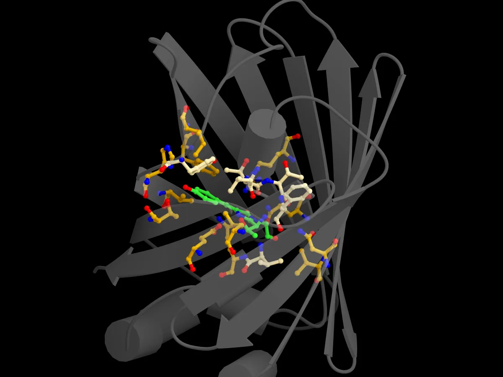
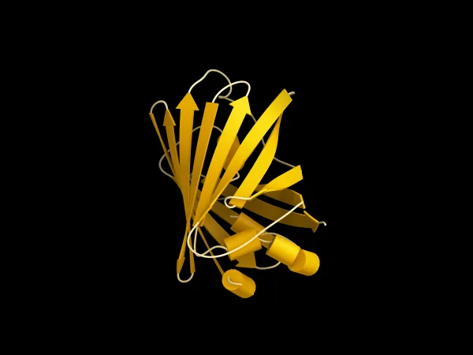

# AI クライアントから CueMol3 を操作する (MCP)

Claude Code などの AI クライアントに言葉で頼んで、CueMol3 で図を作る手順を追います。
CueMol3 の [MCP Server](../../reference/plugins/mcp-server.md) プラグインを有効にすると、
同じコンピュータで動く AI クライアントから、CueMol3 の操作をツールとして呼び出せるようになります。
題材は緑色蛍光タンパク質 GFP (PDB ID: **1EMA**) で、β バレルの内側にある発色団とその周りを表示します。

!!! abstract "このチュートリアルについて"
    - **題材**: 緑色蛍光タンパク質 GFP (PDB ID: 1EMA)
    - **学ぶこと**: MCP Server の有効化、AI クライアントの登録 (Claude Code / Claude Desktop / Codex / Antigravity CLI)、AI への頼み方、AI が行った操作の確認と取り消し、画像とシーンの保存
    - **前提**: AI クライアントのどれかを使えること。GUI の操作は基本操作コースの [Renderer の追加・削除と設定](../basic/renderers.md) まで

{ .on-glb }

同じ依頼でも、AI が選ぶ操作や、その結果の色・向きは、使うクライアントとモデルによって大きく変わります
(同じモデルでも、試すたびに少しずつ違います)。このページの依頼の例を送っても、図と同じになるとは限りません。
AI が何をしたかは、CueMol3 の画面で確かめることができます
(→ [5. AI が行った操作を確かめて戻す](#5-ai-が行った操作を確かめて戻す))。

!!! note "CueMol3 の中だけで使いたいとき"
    CueMol3 には、チャットパネルで指示を出す [AI Agent](../../reference/plugins/ai-agent.md) プラグインもあります。
    外部の AI クライアントは要りませんが、OpenAI・Anthropic・Google のいずれかの API キーが必要です。

## 1. MCP Server を有効にする

1. **Settings &gt; Plugins &gt; Installed** で **MCP Server** を有効にします。
2. ステータスバーの右側に **MCP** が表示されたことを確かめます。

**MCP** をクリックすると、状態が **Ready** (クライアントからの接続を待っている) になっていることを
確かめられます (→ [ステータスバーの MCP](../../reference/plugins/mcp-server.md#ステータスバーの-mcp))。

## 2. AI クライアントを登録する

使う AI クライアントのタブを選んでください。**Set up...** で開くダイアログは、ステータスバーの
**MCP** をクリックして開くポップオーバーの **Clients** にあります。

=== "Claude Code"

    1. **Set up...** で **Connect a client** ダイアログを開き、**Claude Code** を選んで **Copy** を押します。
    2. コピーしたコマンド (`claude mcp add --transport http cuemol ...`) を、Claude Code を使うディレクトリで
       ターミナルに貼り付けて実行します。
    3. `claude mcp list` を実行し、`cuemol` の行が **Connected** になっていることを確かめます。

    既定では、コマンドを実行したディレクトリでだけ使える登録になります。どのディレクトリでも使うときは、
    `claude mcp add` の後に `--scope user` を加えて実行します。

    !!! tip "tritium_cli で登録する"
        [tritium_cli](../../reference/plugins/console/cli.md) が PATH に通っていれば、次のようにも登録できます。
        トークンが要らず、トークンやポートを変えても登録し直す必要がありません。

        ```
        claude mcp add cuemol -- tritium_cli mcp
        ```

=== "Claude Desktop"

    Claude Desktop の設定ファイル `claude_desktop_config.json` に、tritium_cli を登録します。
    ターミナルを使わずに登録できます。

    1. Claude Desktop の **Settings &gt; Developer** で **Edit Config** を押し、設定ファイルを開きます
       (macOS では `~/Library/Application Support/Claude/claude_desktop_config.json`、
       Windows では `%APPDATA%\Claude\claude_desktop_config.json`)。
    2. 次の `"mcpServers"` を書き加えて保存します。ファイルにほかの設定がある場合は、それを残して
       `"mcpServers"` だけを足します。

        ```json
        {
          "mcpServers": {
            "cuemol": {
              "command": "/Applications/CueMol3.app/Contents/Resources/cli/tritium_cli",
              "args": ["mcp"]
            }
          }
        }
        ```

    3. Claude Desktop を一度終了してから、起動し直します (macOS では ++cmd+q++ で終了します。
       ウィンドウを閉じるだけでは設定が読み込まれません)。

    `"command"` は macOS の例です。tritium_cli のパスは、CueMol3 の **Settings &gt; Plugins &gt; Console** の
    **Command line tool** で確かめることができます (**Copy** でコピーできます)。
    この方法では、トークンやポートを変えても登録し直す必要がありません。

=== "Codex"

    1. **Set up...** で **Connect a client** ダイアログを開き、**Codex** を選んで **Copy** を押します。
    2. コピーした内容を `~/.codex/config.toml` の末尾に貼り付けて保存します。
    3. `codex mcp list` を実行し、`cuemol` が表示されることを確かめます。

    貼り付けた内容の `tool_timeout_sec` は消さないでください。Codex は、指定が無いとツールの実行を
    60 秒で打ち切るため、時間のかかるレンダリングが途中で止まります。

=== "Antigravity CLI"

    1. **Set up...** で **Connect a client** ダイアログを開き、**Antigravity** を選んで **Copy** を押します。
    2. コピーした内容を `~/.gemini/config/mcp_config.json` に貼り付けて保存します。ファイルにほかのサーバーが
       登録されている場合は、`"cuemol"` の項目だけを `"mcpServers"` の中に足します。
    3. `agy mcp list` を実行し、`cuemol` が `enabled` になっていることを確かめます。

    この設定ファイルは、Antigravity CLI (`agy`) のものです。

登録できたら、AI クライアントに次のように頼んで、CueMol3 とつながっていることを確かめます。

> CueMol で開いているシーンの一覧を教えてください。

CueMol3 で開いているシーン (タブ) の名前が返ってくれば、つながっています。

## 3. 構造を読み込んでもらう

AI クライアントに、次のように頼みます。

> CueMol で新しいシーンを作って、PDB 1EMA (GFP) を読み込み、cartoon で表示してください。

はじめて CueMol3 のツールを使うときに、AI クライアントが使ってよいか確認を求めることがあります。
許可してください。

AI は、たとえばシーンの作成 (`create_scene`) と PDB からの取得 (`fetch_pdb`) を順に呼び出し、
CueMol3 に新しいタブができて 1EMA が表示されます。ツールを実行している間は、ステータスバーに
**MCP: &lt;ツール名&gt;** と表示されます。

{ width="400" .on-glb }

シーンツリーに `1ema` と `cartoon1` ができていることを確かめます。

## 4. 対話しながら図を作る

続けて、1 つずつ頼んでいきます。前の依頼の結果を見ながら、次の依頼を決めることができます。

> 発色団 (CRO) を ballstick で表示して、その周り 4 Å 以内の残基も ballstick で見せてください。

> cartoon を薄い灰色にして、半透明にしてください。発色団は目立つ色にしてください。

> 発色団がよく見える向きに視点を合わせて、今の画面を見せてください。

AI は、今の画面を画像として受け取るツール (`capture_view`) で表示を確かめながら進めます。
「今の画面を見せて」と頼むと、その画像をクライアントに表示することもあります。

1EMA の発色団は、Thr65-Tyr66-Gly67 の 3 残基が環化してできた 1 つの残基で、
残基名 **CRO**、残基番号 66 です (残基 65 と 67 はありません)。AI が残基の指定を誤ったときは、このように残基名や番号、
選択式 (`resn CRO` など。→ [選択式](../../reference/selection.md)) を具体的に伝えると通じやすくなります。

## 5. AI が行った操作を確かめて戻す

AI が行った操作は、ほかの編集と同じく CueMol3 の Undo の履歴に残ります。

1. アクティビティバーの **Actions** を開きます。
2. **History** パネルに、ツールの呼び出しが 1 回につき 1 行ずつ並んでいることを確かめます。
   行の右には、MCP から行った編集であることを示す `mcp` が表示されます。
3. 行をダブルクリックして、インスペクタでその呼び出しの引数 (選択式や色など) を確かめます。
4. ++cmd+z++ / ++ctrl+z++ を押して、最後の呼び出しを取り消します。

1 回の呼び出しが、1 回の Undo にまとまっています。AI の結果が思ったものと違うときは、
History で何が呼び出されたかを確かめ、必要なところまで戻してから、頼み方を変えてやり直します
(→ [操作の記録と再生 (Actions)](../../reference/actions.md#history-パネル))。
頼み方を変えてもうまくいかないときは、クライアントで別のモデルに切り替えるのも一つの方法です。

取り消しは CueMol3 の側で行います。AI クライアントから Undo を行うことはできません。
取り消した後で続けて頼むときは、「今の画面を確認してから」のように、今の状態を確かめ直すよう
伝えると確実です。

## 6. 画像とシーンを保存する

ファイルに書き出すときは、出力先のパスを指定して頼みます。

> 今の画面を 1600×1200 の PNG で、デスクトップの 1ema_chromophore.png に保存してください。

> このシーンを、デスクトップの 1ema_mcp.qsc に保存してください。

AI は、頼まれたときにだけファイルを書き出します。保存したファイルの場所は、AI が返答で伝えます。

ここまでの操作を、AI を使わずに繰り返したいときは、**History** パネルで行を選んで **Save as qax** を
押すと、qax ファイルに保存できます (→ [操作の記録と再生 (Actions)](../../reference/actions.md))。

## 7. うまくいかないとき

`CueMol is busy` と返ってくる
:   一度に CueMol3 を操作できるのは 1 つのクライアントだけです。Console のコマンド、AI Agent の指示、
    ほかの MCP クライアントや tritium_cli の実行が終わってから、やり直してください。

ステータスバーの MCP が **Error** になる
:   サーバーを開始できていません。ほかのプログラムがポート (既定は 27182) を使っている場合は、
    **Settings &gt; Plugins &gt; MCP Server** の **Port** を変えます
    (→ [MCP Server](../../reference/plugins/mcp-server.md#有効にする))。

トークンやポートを変えた後につながらない
:   **Set up...** で表示された内容で登録したクライアント (Claude Code / Codex / Antigravity CLI) は、
    登録し直してください。tritium_cli で登録したもの (Claude Desktop と、Claude Code の tip の方法) は、
    登録し直す必要はありません。

## 次のステップ

- [MCP Server](../../reference/plugins/mcp-server.md) — 設定項目・クライアントの登録・セキュリティ
- [操作の記録と再生 (Actions)](../../reference/actions.md) — History と qax ファイル
- [tritium_cli](../../reference/plugins/console/cli.md) — ターミナルからのコマンドの実行と、AI エージェント向けの説明 (`tritium_cli skill`)
- [AI Agent](../../reference/plugins/ai-agent.md) — CueMol3 の中のチャットパネル

---

*確認対象: CueMol3 3.0.6.577*
