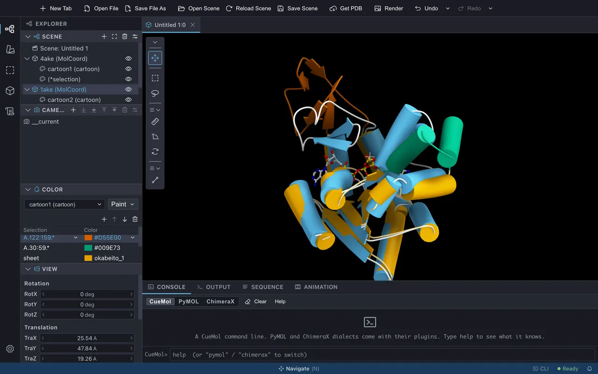
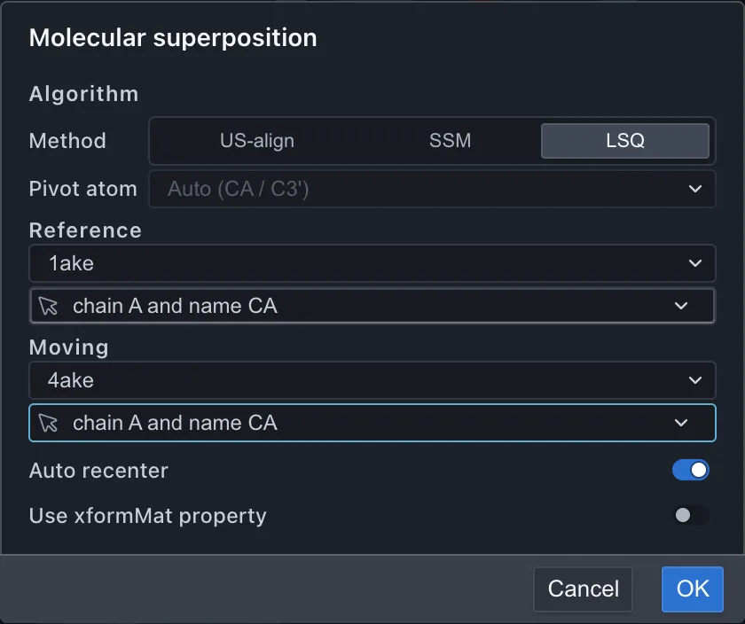
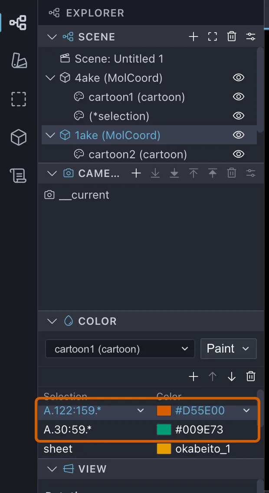

# 構造の重ね合わせと比較

同じタンパク質の 2 つの結晶構造を重ね合わせ、どの部分がどれだけ動いているかを比べる手順を追います。
題材にはアデニル酸キナーゼを使います。基質の無い開いた構造 (PDB ID: **4AKE**) と、
阻害剤 Ap5A が結合して閉じた構造 (PDB ID: **1AKE**) です。
2 つのドメインが大きく動くので、重ね合わせに使う原子の選び方で結果がどう変わるかがよくわかります。

!!! abstract "このチュートリアルについて"
    - **題材**: アデニル酸キナーゼの開いた構造 (PDB ID: 4AKE) と閉じた構造 (PDB ID: 1AKE)
    - **学ぶこと**: LSQ による重ね合わせ、重ね合わせに使う原子の選び方と RMSD の読み方、Paint によるドメインの塗り分け
    - **前提**: 基本操作コースの [Renderer の着色](../basic/coloring.md) まで

{ .on-glb }

## 1. 2 つの構造を読み込む

1. **File &gt; Get PDB...** で `4AKE` を取得します。Renderer は **cartoon** を選び、
   **Selection** にチェックを入れて **Atoms** に `chain A` を入力します。
2. 同じように `1AKE` を取得します (Renderer は **cartoon**、**Atoms** は `chain A`)。

どちらも非対称単位に 2 本の鎖 (chain A / B) を含むので、chain A (残基 1〜214) だけを表示します。
読み込んだ分子は、分子ごとの既定の色で塗られます。シーンの最初の分子の 4AKE は橙、
2 番目の 1AKE は水色です。

1AKE の chain A には、阻害剤 Ap5A (残基名 **AP5**) が結合しています。位置がわかるように
ballstick で表示しておきます。

1. シーンツリーで `1ake` を右クリックし、**New Renderer...** を選びます。
2. **Renderer type** から **ballstick** を選び、**Selection** にチェックを入れて
   **Atoms** に `chain A and resn AP5` を入力します。
3. **Create** を押します。

## 2. 全体の Cα で重ね合わせる

まず、chain A の Cα 原子すべてを使って重ね合わせます。

**Tools &gt; Molecular superposition...** で **Molecular superposition** ダイアログを開きます
(→ [分子の重ね合わせ (Molecular superposition)](../../reference/tools/superpose.md))。

1. **Method** で **LSQ** を選びます。
2. **Reference** の Molecule で `1ake` を選び、Selection に `chain A and name CA` を指定します。
3. **Moving** の Molecule で `4ake` を選び、Selection に `chain A and name CA` を指定します。
4. **OK** を押すと、4AKE が 1AKE に重なるように移動します。

    { width="420" .on-glb }


LSQ は、2 つの Selection で選んだ原子を順に対応づけて、ずれの二乗和が最小になるように重ね合わせます
(2 つの構造は配列と残基番号が同じなので、Cα が 214 個ずつ、同じ順に並びます)。
下部パネルの **Output** に表示される **RMSD** は約 7.1 Å です。

分子を回して見ると、どこもまんべんなくずれていて、どの部分が動いたのかは読み取れません。
大きく動いた部分のずれを小さくしようとして、動いていない部分まで引きずられるためです。

## 3. 動かない部分で重ね合わせる

アデニル酸キナーゼは、3 つのドメインからできています。

| ドメイン | 残基 | 役割 |
|---|---|---|
| CORE | 1〜29、60〜121、160〜214 | 骨格になる部分 |
| NMP | 30〜59 | AMP が結合する部分 |
| LID | 122〜159 | ATP の上に蓋をする部分 |

動かない CORE の Cα だけを使って、重ね合わせをやり直します。

1. もう一度 **Molecular superposition** ダイアログを開きます (前回の設定が残っています)。
2. **Reference** と **Moving** の Selection を、どちらも次の式にします。

    ```
    A.1:29,60:121,160:214.CA
    ```

    chain A の残基 1〜29、60〜121、160〜214 の CA 原子 (146 個) です
    (→ [選択式の文法](../../reference/selection.md#階層表記-hierarchical-notation))。

3. **OK** を押します。

**RMSD** は約 2.0 Å になります。CORE はよく重なり、NMP と LID が離れている様子が見えるようになります。

!!! note "RMSD の比べ方"
    RMSD は、重ね合わせに使った原子だけについての値です。2. の約 7.1 Å (214 個) と
    3. の約 2.0 Å (146 個) は対象の原子が違うので、「重ね合わせが良くなった」という比較ではありません。
    3. の値は「CORE の形が 2 つの構造でどれだけ似ているか」を表します。

## 4. ドメインを塗り分ける

4AKE の NMP と LID に色を付けて、動いた部分をはっきりさせます。

1. 左サイドパネルの **Explorer &gt; Color** パネルを開き、上部で `4ake/cartoon1` を選びます。
2. Coloring の種類から **Paint coloring** &gt; **Okabe-Ito** &gt; **Orange** を選びます。
3. 表の一番上に行を追加し、選択式に `A.30:59.*`、色に Okabe-Ito の **Bluish green** (`#009E73`) を指定します。
4. もう一度、表の一番上に行を追加し、選択式に `A.122:159.*`、色に Okabe-Ito の **Vermillion** (`#D55E00`) を指定します。

4AKE の NMP が緑、LID が朱色になります (→ [Renderer の着色](../basic/coloring.md))。

{ width="310" .on-glb }

{ .on-glb }

分子を回して、ドメインの動きを確かめてください。

- 閉じた 1AKE (水色) では、LID と NMP が Ap5A を両側から包んでいます。
- 開いた 4AKE では、LID (朱色) と NMP (緑) が CORE から離れる向きに開いています。
  LID の先端では、同じ残基の Cα の位置が 20 Å 以上離れています。

## 同じことをコマンドで

本文の操作を [Console](../../reference/plugins/console/index.md) の native モードのコマンドで書くと、
次のようになります。Console に 1 行ずつ入力します ([tritium_cli](../../reference/plugins/console/cli.md)
からも実行できます)。各コマンドの引数は Console で `help <コマンド>` を実行すると確認できます
(→ [Console のコマンド一覧](../../reference/plugins/console/commands.md))。

```
# 1. 2 つの構造を読み込む
fetch_pdb 4AKE, mmcif, cartoon, selection="chain A"
fetch_pdb 1AKE, mmcif, cartoon, selection="chain A"
create_renderer 1ake, ballstick, selection="chain A and resn AP5"
# 2. 全体の Cα で重ね合わせる
superpose 4ake, 1ake, movSel="chain A and name CA", refSel="chain A and name CA", algo=LSQ
# 3. 動かない部分で重ね合わせる
superpose 4ake, 1ake, movSel="A.1:29,60:121,160:214.CA", refSel="A.1:29,60:121,160:214.CA", algo=LSQ
# 4. ドメインを塗り分ける
set_renderer_coloring 4ake/cartoon1, paint-type-paint, paintColor=okabeito_1
add_paint 4ake/cartoon1, "A.30:59.*", #009E73
add_paint 4ake/cartoon1, "A.122:159.*", #D55E00
set_mol_selection 4ake, ""
```

- `superpose` は、重ね合わせの結果 (RMSD など) をコマンドの出力には返しません。値は Output パネルで確認します。
- `add_paint` は、塗った範囲を分子の選択にもします。選択のハイライトが図に残らないように、
  最後に `set_mol_selection` で選択を解除しています。

## 次のステップ

開いた構造と閉じた構造の間をつなぐ動画は、モーフィングで作ることができます
(→ [アニメーションの作成と動画の出力](../animation/animation-movie.md)。モーフィングの節では別の題材を使っています)。

- [分子の重ね合わせ (Molecular superposition)](../../reference/tools/superpose.md) — US-align / SSM / LSQ の違いと Output の項目
- [構造変化のモーフィング (Mol morphing animation)](../../reference/tools/morphing.md)

---

*確認対象: CueMol3 3.0.6.577*
