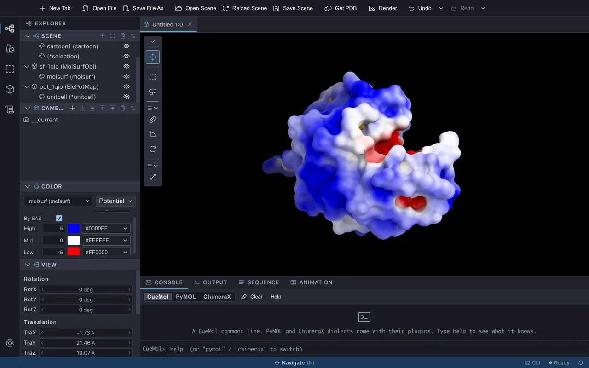
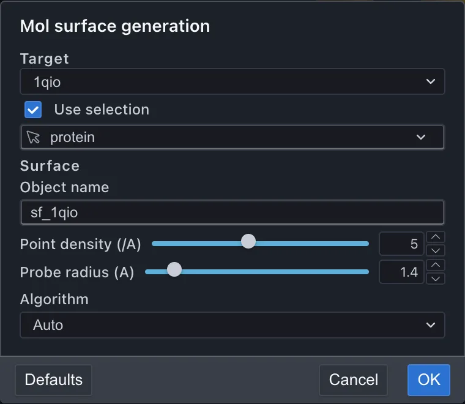
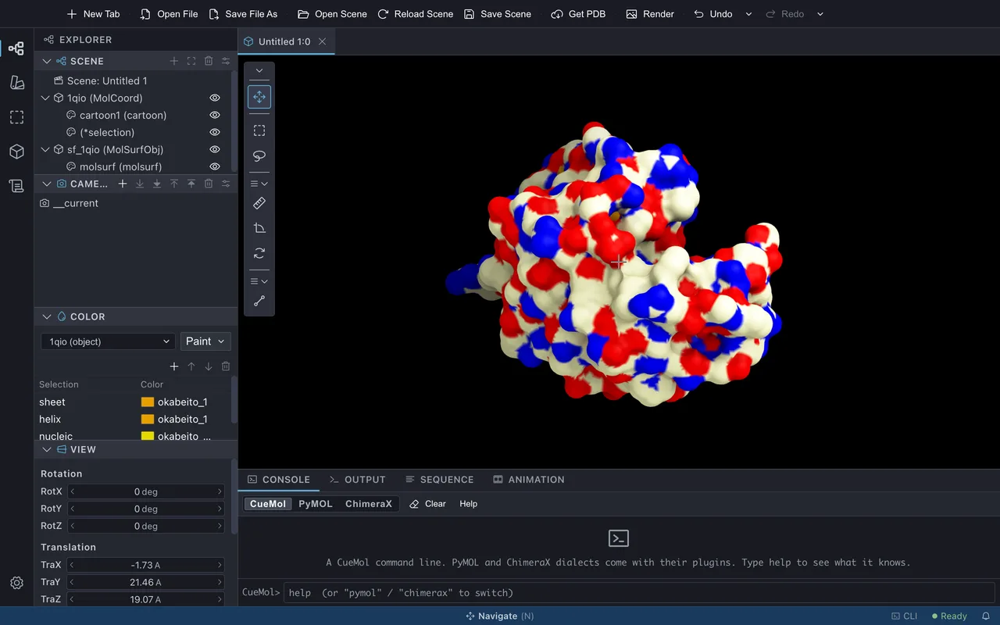
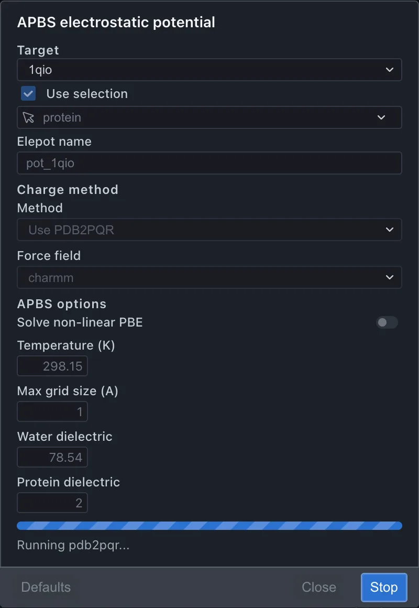
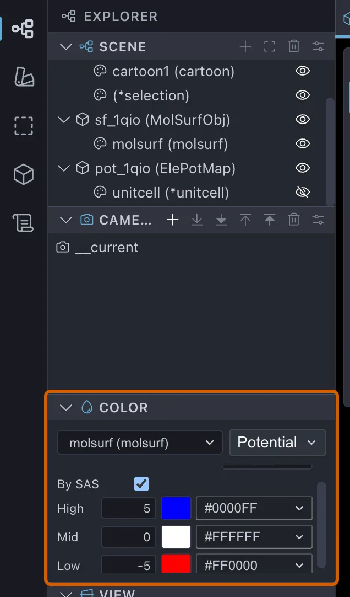
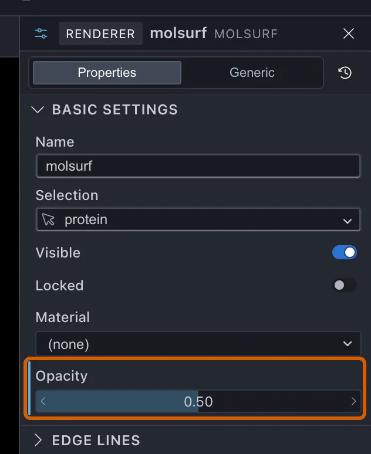
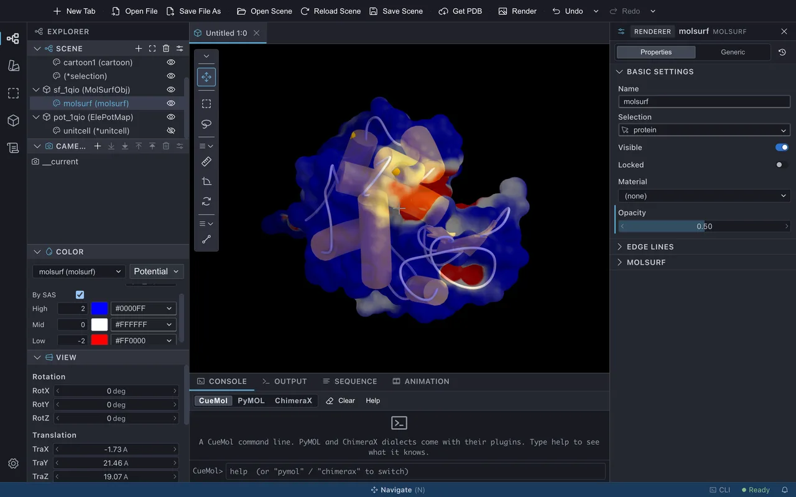

# 分子表面の静電ポテンシャル表示

分子表面を生成し、APBS で計算した静電ポテンシャルで着色して、
分子の電荷の偏りを示す図を作る手順を追います。
題材にはリゾチーム (PDB ID: **1QIO**) を使います。塩基性のタンパク質なので、
正電荷に偏った表面がはっきり見えます。

!!! abstract "このチュートリアルについて"
    - **題材**: リゾチーム (PDB ID: 1QIO)
    - **学ぶこと**: 分子表面の生成、APBS による静電ポテンシャルの計算、表面の着色、半透明の表面と cartoon の重ね合わせ
    - **前提**: 基本操作コースの [Renderer の着色](../basic/coloring.md) まで

{ .on-glb }

## 1. 構造を読み込む

**File &gt; Get PDB...** で `1QIO` を取得します (座標のみで構いません)。
Renderer は **cartoon** を選んでおきます。

## 2. 分子表面を生成する

**Tools &gt; Mol surface generation...** を開きます。

1. **Target** の **Molecule** で 1QIO を選びます。
2. **Use selection** を有効にし、選択式に `protein` を指定します。結晶構造には
   水分子が含まれており、そのままでは水の粒まで表面が計算されてしまうためです。
3. **Point density (/A)** を **5** に上げます。表面の細かさの設定で、1QIO のような
   小さなタンパク質では上げるときれいな表面になります (巨大な分子では既定の 2 の
   ままの方が軽快です)。
4. **Object name** と **Probe radius (A)** (水分子の半径 1.4 Å) は既定のままで構いません。
5. **Algorithm** も既定の **Auto** のままで構いません (→
   [MolSurfObj (分子表面)](../../reference/objects/molsurf.md#生成アルゴリズム-algorithm))
6. OK を押すと、分子表面の Object と molsurf Renderer が作られ、表面が表示されます。

{ width="380" .on-glb }

{ .on-glb }

MolSurf Object は表面の形状だけを保持しており、molsurf Renderer はインスペクタの
**Selection mol** に指定された分子 (生成元の 1QIO) を参照して着色や選択を行います。
表面の一部だけを表示したいときは **Selection** で範囲を指定できます。
詳細は [MolSurf](../../reference/objects/molsurf.md) /
[molsurf](../../reference/renderers/molsurf.md) を参照してください。

## 3. 静電ポテンシャルを計算する

**Tools &gt; APBS elepot calculation...** を開きます。

1. **Target** の **Molecule** で 1QIO を選びます。
2. こちらも **Use selection** を有効にし、`protein` を指定します
   (水やイオンを除いて計算するのが普通です)。
3. **Elepot name** (作られる静電ポテンシャルマップ Object の名前) は既定のままで構いません。
4. **Charge method** の **Method** は既定の **Use PDB2PQR** のままにします。
5. **Start** を押すと、pdb2pqr → apbs の順に計算が走り、進捗が表示されます。
   分子が大きい場合は時間がかかります。完了すると静電ポテンシャルマップ (ElePotMap) の
   Object がシーンに追加されます。

APBS と pdb2pqr は macOS / Windows の配布物に同梱されており、通常はインストールや
設定は不要です。同梱されていないビルド (Linux など) では、別途インストールして
Settings でパスを指定します (→ [外部ツールの設定](../../install/external-tools.md))。

{ width="400" .on-glb }

温度や誘電率などの計算条件は **APBS options** で変更できます。
シーンには、マップが計算された範囲を示す枠 (`*unitcell` Renderer) も追加されます。
範囲が十分なことを確かめたら、非表示にして構いません。
静電ポテンシャルマップ Object の詳細は [ElePotMap](../../reference/objects/elepot.md) を
参照してください。

## 4. 表面を静電ポテンシャルで着色する

1. 左サイドパネルの **Explorer &gt; Color** パネルを開きます。
2. 上部で molsurf の Renderer を選びます。
3. Coloring の種類から **Electrostatic potential** を選びます。
4. **Potential** で、手順 3 で作った静電ポテンシャルマップを選びます。
5. **By SAS** を有効にします。表面 (SES) 上の値そのままでは電荷のある原子に近すぎて
   まだらな着色になりがちなので、表面から水分子の半径 (1.4 Å) だけ外側の
   溶媒接触表面 (SAS) 上の値で着色します。
6. **High** を **2**、**Low** を **-2** 程度にします。値の単位は kT/e で、
   既定の ±10 のままでは色がほとんど付きません。範囲を狭めるほど
   コントラストが強くなります。

設定項目の詳細は [Coloring](../../reference/coloring.md) を参照してください。

{ width="318" .on-glb }

{ .on-glb }

## 5. 半透明の表面と cartoon を重ねる

表面の内側の構造も見せたい場合は、表面を半透明にして cartoon と重ねます。

1. 左サイドパネルの **Explorer &gt; Scene** ツリー (シーンツリー) で
   molsurf の Renderer を選びます。
2. プロパティインスペクタの **Basic settings** セクションで **Opacity** を 0.5 前後に下げます。

表面越しに主鎖の走行が見える、定番の重ね図になります。
仕上げと書き出しは [論文用の高解像度画像の書き出し](../figures/publication-images.md) を参照してください。

{ width="316" .on-glb }

{ .on-glb }

## 同じことをコマンドで

本文の操作を [Console](../../reference/plugins/console/index.md) の native モードのコマンドで書くと、
次のようになります。Console に 1 行ずつ入力します ([tritium_cli](../../reference/plugins/console/cli.md)
からも実行できます)。各コマンドの引数は Console で `help <コマンド>` を実行すると確認できます
(→ [Console のコマンド一覧](../../reference/plugins/console/commands.md))。

```
# 1. 構造を読み込む
fetch_pdb 1QIO, mmcif, cartoon
# 2. 分子表面を生成する
create_surface 1qio, protein, density=5
# 3. 静電ポテンシャルを計算する
calc_elepot 1qio, protein
hide pot_1qio/unitcell
# 4. 表面を静電ポテンシャルで着色する
set_elepot_coloring sf_1qio/molsurf, pot_1qio, -2, 2
set sf_1qio/molsurf.ramp_above, true
# 5. 半透明の表面と cartoon を重ねる
set sf_1qio/molsurf.alpha, 0.5
```

- コマンドで作ると、分子表面の Object は `sf_1qio`、静電ポテンシャルマップの Object は
  `pot_1qio` という名前になります。
- `ramp_above` は Color パネルの **By SAS**、`alpha` はインスペクタの **Opacity** にあたります。

## 次のステップ

- [論文用の高解像度画像の書き出し](../figures/publication-images.md) — この図をレイトレースで仕上げる
- [Coloring](../../reference/coloring.md) — 静電ポテンシャルの設定項目
- [MolSurf](../../reference/objects/molsurf.md) / [ElePotMap](../../reference/objects/elepot.md) — 生成される Object の詳細

---

*確認対象: CueMol3 3.0.6.577*
