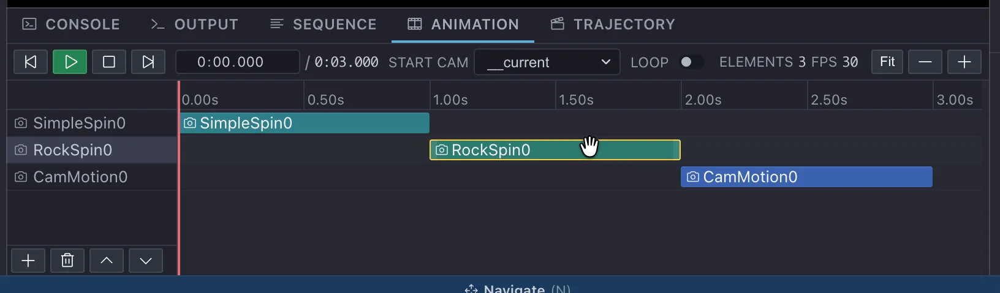

# Animation パネル

下部パネルの **Animation** タブで、アニメーションのタイムラインを編集します。
Blender のようなストリップ形式で、1 つのアニメーション要素が 1 本の帯として表示されます。
要素の種類と設定は [アニメーション](../../reference/animation/index.md) を参照してください。

## パネルの構成

{ width="816" .on-glb }

| 場所 | 内容 |
|---|---|
| ヘッダ | 再生の操作、現在時刻と全体の長さ、開始カメラ (**Start cam**)、ループ (**Loop**)、要素の数 (**Elements**) とフレームレート (**FPS**)、表示の拡大・縮小 |
| 左の列 | 要素の名前の一覧と、要素を追加・削除・並べ替えるツールバー |
| 右の領域 | 時間の目盛りと、要素の帯 |

## 要素を編集する

- 左の列のツールバーの **Add element** (+) から種類を選ぶと、要素が追加されます。
  **Delete element** で削除、**Move up** / **Move down** で並べ替えます。
- 帯をドラッグして開始位置を移動、端をドラッグして長さを変更できます。
  ドラッグ中は、帯の近くに長さと開始・終了の時刻が表示されます。
  開始時刻 (移動と左端のドラッグ) や長さ (右端のドラッグ) は時間の目盛りの 1/10 の間隔に揃います。
  ++alt++ (++option++) を押しながらドラッグすると、揃えずに自由に動かすことができます。
  タイムラインの終わりを越えてドラッグすると、タイムラインが伸びます。
- 帯を選ぶと右側のインスペクタにその要素の詳細設定が表示されます
  (種類ごとの設定と、汎用のプロパティ一覧)。
- 開始時刻の基準 (Relative to) が解決できない要素は斜線付きで表示され、修正されるまで
  再生できません。

### コピー &amp; ペースト

選んだ帯は **Edit &gt; Cut** / **Copy** / **Paste** (++cmd+x++ / ++cmd+c++ / ++cmd+v++) で複製できます。
貼り付けた要素は、選んでいる帯の直後 (選んでいなければ末尾) に挿入されます。
長さはコピー元と同じです。名前が重なる場合は番号が付け直されます。別のシーンへの貼り付けも可能です。

## 再生する

- ヘッダの再生ボタンで、アニメーションを実際に分子ビュー上で再生できます。
  ボタンは左から **Skip to start** / **Play** (再生中は **Pause**) / **Stop** / **Skip to end** です。
- 現在時刻の表示は編集できます。時刻を打ち込んで ++enter++ を押すとその時点へ移動します
  (→ [時刻の入力](../inspector.md#時刻の入力))。
- **Loop** を ON にすると、タイムライン全体を繰り返し再生します。
- **Fit** でタイムライン全体をパネルの幅に収め、**-** / **+** で表示を縮小・拡大します。

!!! note
    アニメーションのプロパティを編集している最中は、分子ビューはリアルタイムには追従しません。
    再生して確認してください。

## 開始カメラ

ヘッダの **Start cam** で開始カメラを選択できます。開始カメラが無いときに要素を追加・貼り付けすると、
`__current` (現在の視点) が開始カメラになります。`__current` は停止した状態から再生を始める直前に
そのときの視点で更新されるので、再生は今見ている視点から始まります (一時停止からの再開では
更新されません)。決まった視点から始めたいときは、名前を付けたカメラを開始カメラに選択します
(→ [カメラ](../../reference/camera.md#__current))。

## 動画に書き出す

作成したアニメーションを動画ファイルとして出力するには、
**Rendering &gt; Movie rendering...** を使用してください (→ [レンダリングウィンドウ](../rendering-window.md))。

## 関連項目

- [アニメーション](../../reference/animation/index.md) — 要素の種類と共通プロパティ
- [アニメーションを作って動画に出力する](../../tutorials/animation/animation-movie.md)
- [下部パネル](index.md)
- [プロパティインスペクタ](../inspector.md)

---

*確認対象: CueMol3 3.0.3.565*
