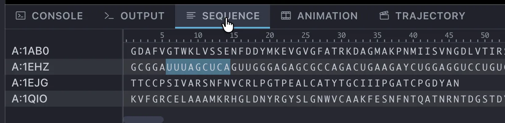

# 下部パネル

ウィンドウ下部のパネルは、既定では 4 つのタブを持ちます。

{ width="598" .on-glb }

| タブ | 内容 |
|---|---|
| **Console** | コマンドライン (→ [Console](../../reference/plugins/console/index.md)) |
| **Output** | ログ表示 |
| **Sequence** | 分子のアミノ酸・塩基配列の表示と選択 (→ [Sequence パネル](sequence.md)) |
| **Animation** | アニメーションのタイムライン編集 (→ [Animation パネル](animation.md)) |

[プラグイン](../../reference/plugins/index.md)を有効にすると、次のタブが加わります。
**Console** タブも Console プラグインの一部で、無効にすると表示されなくなります。

| タブ | 内容 | プラグイン |
|---|---|---|
| **Trajectory** | MD トラジェクトリの再生 (→ [Trajectory パネル](trajectory.md)) | MD Tools |

## Output

アプリケーションのログを表示します。ファイルの読み込み結果やエラーメッセージがここに出ます。

- ++cmd+a++ (Edit &gt; Select All) でログ全体を選択し、コピーできます。

## Sequence

読み込まれている分子の配列を、チェインごとに 1 行の格子で表示します。クリックやドラッグで
残基を選択できます。詳しくは [Sequence パネル](sequence.md) を参照してください。

## Animation

アニメーションのタイムラインを編集します。1 つのアニメーション要素が 1 本の帯として表示され、
帯の追加・移動・コピー &amp; ペーストや再生を行えます。詳しくは
[Animation パネル](animation.md) を参照してください。

## Console

CueMol の操作をコマンドで実行するコマンドラインです。ツールバーで PyM console に切り替えると、
`fetch 1crn` のような PyMOL のコマンドもそのまま打てます。ChX console では、`open 1crn` のような
ChimeraX のコマンドを打てます。

このタブは **Console** プラグインの一部で、**既定で有効**です
(→ [Console](../../reference/plugins/console/index.md))。下部パネルの先頭のタブで、ほかのタブを
選ぶまでは前面に表示されます。

## Trajectory

MD トラジェクトリを再生します。タイムライン上にフレームのブロックが表示され、再生・コマ送り・
シークやブロックの編集ができます。詳しくは [Trajectory パネル](trajectory.md) を参照してください。

このタブは **MD Tools** プラグインの一部で、**既定では無効**です
(→ [プラグイン](../../reference/plugins/index.md))。

---

*確認対象: CueMol3 3.0.2.560*
