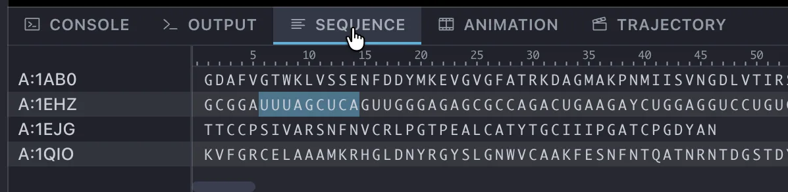

# Sequence パネル

下部パネルの **Sequence** タブで、読み込まれている分子の配列を表示し、残基を選択します。

## 表示

{ width="598" .on-glb }

読み込まれている分子の配列を、チェインごとに 1 行の格子で表示します。
分子ごとの切り替えはなく、シーン内のすべての分子のチェインが並びます。

- 左側の名前列には、各行のチェインと分子の名前が `<チェイン>:<分子名>` の形で表示されます。
- 格子の上には残基の位置を示す目盛りが表示されます。
- 選択されている残基は色付きで表示され、最後にクリックした位置には枠が付きます。

左側の名前列と配列の格子の境界はドラッグで幅を変えられます。

## 操作

| 操作 | 動作 |
|---|---|
| クリック | その残基の選択を切り替え、分子ビューの表示をその残基の位置に移動します。 |
| ドラッグ | 始点から終点までの残基の選択を切り替えます。 |
| ++shift++ + クリック | 直前にマークした位置からクリック位置までを選択します。 |
| 右クリック | 下記のメニューが開きます。 |

## 右クリックメニュー

| 項目 | 動作 |
|---|---|
| Toggle sel | その残基の選択を切り替えます。 |
| Around 3 / 5 / 7 / 10 | 選択範囲から指定距離以内の原子を選択します。 |
| Around Byresid 3 / 5 / 7 / 10 | 同上。ただし残基単位で選択します。 |
| Unselect all | 選択をすべて解除します。 |
| Invert sel | 選択を反転します。 |
| Copy sequence | 配列を 1 文字表記でクリップボードにコピーします (対応する 1 文字表記がない残基は `*`)。 |
| Center here | その残基を分子ビューの中心に持ってきます。 |

!!! warning "既知の問題: 選択の反映が遅れます"
    選択を変更してから分子ビューのハイライトが更新されるまで、体感で 0.5 秒ほどの遅れが出ることがあります。
    調査中の既知の問題です。

## 関連項目

- [下部パネル](index.md)
- [分子の一部を選択する](../../tutorials/basic/selection.md)
- [選択式の文法](../../reference/selection.md)

---

*確認対象: CueMol3 3.0.2.560*
